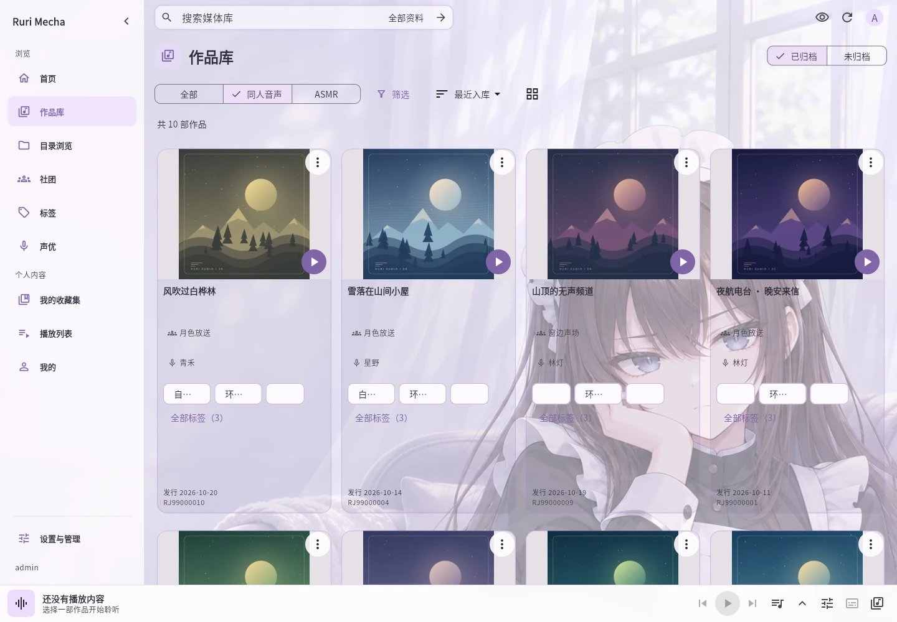

# Rurimecha · Your private ASMR and doujin audio library

[简体中文](README.md) · [繁體中文](README.zh-Hant.md) · [日本語](README.ja.md) · [English](README.en.md)

Find your collection by voice actor, circle, title, or RJ number. Choose a version with or without sound effects, follow transcripts, and resume where you left off. Add your own media folders; Ruri does not provide audio works.

[Try the demo](https://asmr.rurimecha.top/) · [Download](https://github.com/rurimecha/rurimecha/releases/latest) · [User guide](docs/i18n/en/USAGE.md)

> **Older Android clients are incompatible with the new server. Update both together.**

The demo offers guest access; guest favorites and listening progress are not saved.

- Find works by cover, voice actor, circle, tags, or RJ number; edit details and fetch supported metadata.
- Organize works in collections, save exact track order in playlists, and browse smart discovery.
- Follow timed transcripts, use the sleep timer, seek by 10 seconds, and resume playback.
- Hide covers and text with privacy mode; Android supports background playback and floating subtitles.

Install the MSI on Windows or run the server on Linux or Docker. Install the Android APK to add folders on your phone or connect to a server. Ordinary playback and downloads, creating user accounts, and browsing more voice actors are free. Completed downloads play offline.

Saved clips, AI, and Smart routing on the server require a license. Use the same key to activate the server and Android separately, one slot each. A server library uses that server’s license. For work translation on Android, choose the on-device or remote gateway. Cloud models require an Internet connection.

Check for updates under Settings → Version and updates or on the Android connection screen. Open the new MSI on Windows or follow the Android system installer. On Linux, run the new installer on the host. For Docker, replace the image using the guide.

Request a free trial key by email on the Ruri website. Activate within 7 days of issue and use it for 31 days after first activation. Future pricing is provisionally CNY 10/month, CNY 60/year, or CNY 90 for a lifetime license, with up to three devices sharing a key. See the official announcement for the final plan. [Ruri website](https://rurimecha.top/)

[Features](docs/i18n/en/FEATURES.md) · [User guide](docs/i18n/en/USAGE.md)

Ruri is for personal, non-commercial use. It does not distribute media. Please use your content and connected sources in accordance with their terms and applicable law. Bundled FFmpeg and FFprobe are provided under GPLv3 or later; their corresponding source is available on the release page. See the [full terms](README.md#免责声明).
