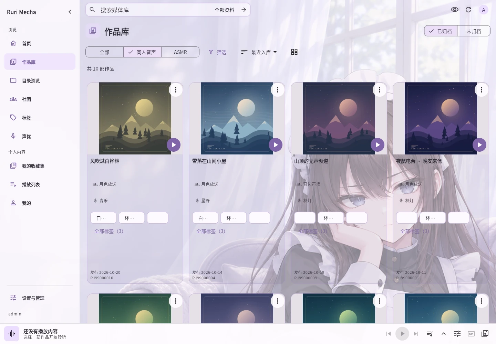

# Rurimecha · Your private ASMR and doujin audio library

[简体中文](README.md) · [繁體中文](README.zh-Hant.md) · [日本語](README.ja.md) · [English](README.en.md)

Find your collection by voice actor, circle, title, or RJ number. Choose a version with or without sound effects, follow transcripts, and resume where you left off. Add your own media folders; Ruri does not provide audio works.

[Try the demo](https://asmr.rurimecha.top/) · [Download](https://github.com/rurimecha/rurimecha/releases/latest) · [User guide](docs/i18n/en/USAGE.md)

The demo offers guest access; guest favorites and listening progress are not saved.

- Find works by cover, voice actor, circle, tags, or RJ number; edit details and fetch supported metadata.
- Organize works in collections, save exact track order in playlists, and browse smart discovery.
- Follow timed transcripts, use the sleep timer, seek by 10 seconds, and resume playback.
- Hide covers and text with privacy mode; Android supports background playback and floating subtitles.

Windows has an MSI installer with no command line. Linux and Docker run a Ruri server; Android connects to a running server. The built-in administrator can use the web app and WebDAV without a license. Android online playback, downloads, and saved clips need an active server license. Completed downloads play offline.

Testing is free. Future pricing is provisionally CNY 10/month, CNY 60/year, or CNY 90 for a lifetime license, with up to 3 server bindings; clients such as Android do not use additional bindings. The final plan will be announced later. Existing free features will remain free. Current free trial licenses require an application and review, first activation within 7 days of issue, and last 31 days after first activation.

[Features](docs/i18n/en/FEATURES.md) · [User guide](docs/i18n/en/USAGE.md)

Ruri is for personal, non-commercial use. It does not distribute media. Please use your content and connected sources in accordance with their terms and applicable law. Bundled FFmpeg and FFprobe are provided under GPLv3 or later; their corresponding source is available on the release page. See the [full terms](README.md#免责声明).
