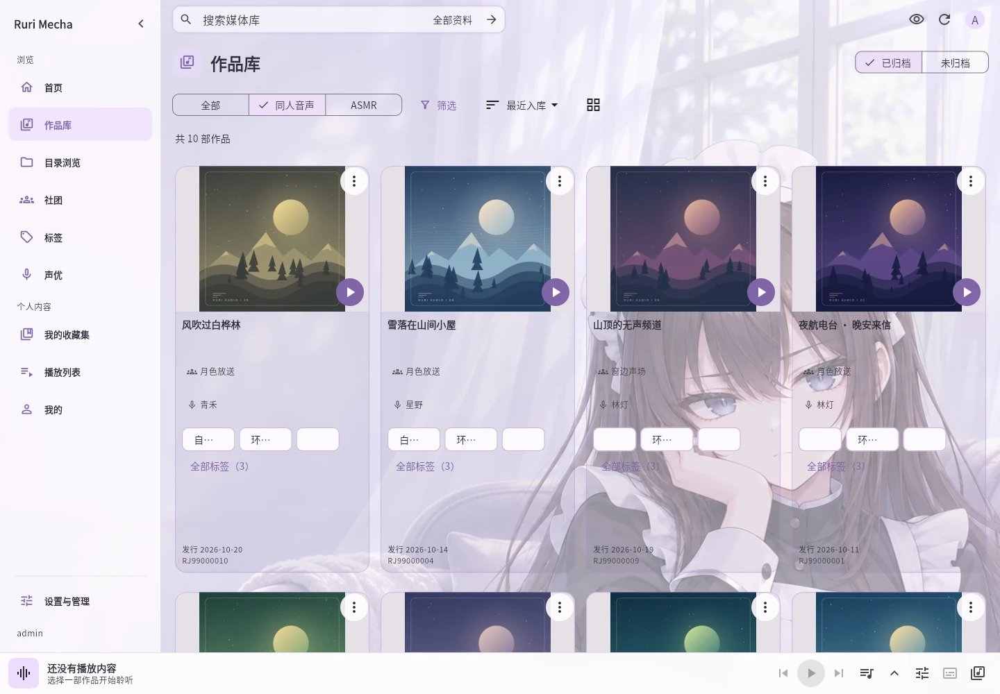

# Rurimecha · ASMR・同人音声のためのプライベートライブラリ

[简体中文](README.md) · [繁體中文](README.zh-Hant.md) · [日本語](README.ja.md) · [English](README.en.md)

声優・サークル・タイトル・RJ 番号から作品を探し、効果音あり・なしを選んで台本を読みながら聴けます。続きから再生でき、自分で用意したメディアフォルダーを追加します。Ruri は音声作品を提供しません。

[デモを試す](https://asmr.rurimecha.top/) · [ダウンロード](https://github.com/rurimecha/rurimecha/releases/latest) · [使い方](docs/i18n/ja/USAGE.md)

> **旧バージョンの Android アプリは新しいサーバーに接続できません。両方を一緒に更新してください。**

デモではゲスト体験を選べます。ゲストの保存と再生位置は記録されません。

- カバー、声優、サークル、タグ、RJ 番号で探し、対応する情報の取得・編集ができます。
- 作品をコレクションにまとめ、プレイリストに順番を保存し、スマート発見から探せます。
- 時間付き台本、スリープタイマー、10 秒移動、続きからの再生に対応します。
- プライバシーモードでカバーや文字を隠し、Android ではバックグラウンド再生・字幕表示ができます。

Windows は MSI でインストールできます。Linux または Docker ではサーバーを動かせます。Android に APK をインストールすると、端末のフォルダーを追加したりサーバーに接続したりできます。通常の曲の再生とダウンロード、アカウント作成、声優一覧の閲覧は無料です。ダウンロード済みの曲はオフラインで再生できます。

お気に入りクリップ、AI、サーバーのスマート接続にはライセンスが必要です。同じキーでサーバーと Android 端末を個別に有効化でき、それぞれ 1 枠を使います。サーバーのライブラリに接続中は、そのサーバーのライセンスが適用されます。Android のローカルライブラリでは、端末内またはリモートのゲートウェイを選んで作品情報を翻訳できます。クラウドモデルにはインターネット接続が必要です。

「設定 → バージョンと更新」や Android の接続画面から更新を確認できます。Windows では新しい MSI を、Android ではシステムのインストーラーを開きます。Linux はホストで新しいインストーラーを実行し、Docker はガイドに沿ってイメージを更新してください。

無料の試用キーは、Ruri の公式サイトでメールアドレスを入力して受け取れます。発行後 7 日以内に初回有効化すると、その日から 31 日間使えます。将来は月額 10 元、年額 60 元、永久ライセンス 90 元で、同じキーで最大 3 台まで有効化できる予定です。最終的な内容は正式発表をご確認ください。[Ruri 公式サイト](https://rurimecha.top/)

[Features](docs/i18n/ja/FEATURES.md) · [使い方](docs/i18n/ja/USAGE.md)

Ruri は個人的な非商用利用を対象とし、作品を配布しません。コンテンツと接続先は権利者の許諾、利用規約、適用法に従って利用してください。同梱の FFmpeg・FFprobe は GPLv3 以降で提供し、対応するソースはリリースページから取得できます。[利用条件](README.md#免责声明)
