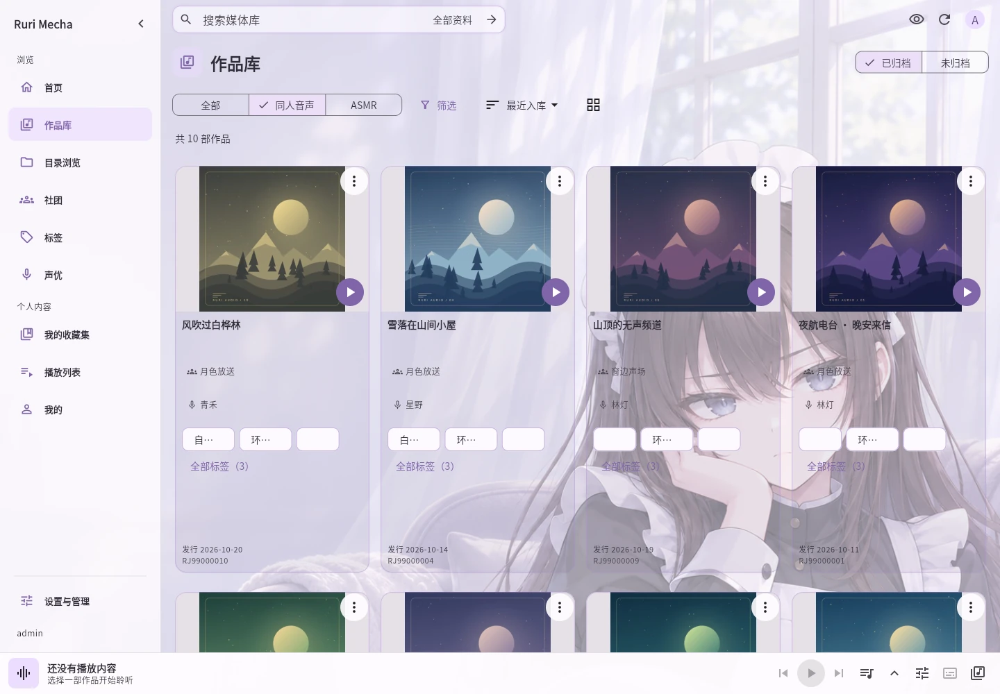

# Rurimecha · ASMR・同人音声のためのプライベートライブラリ

[简体中文](README.md) · [繁體中文](README.zh-Hant.md) · [日本語](README.ja.md) · [English](README.en.md)

声優・サークル・タイトル・RJ 番号から作品を探し、効果音あり・なしを選んで台本を読みながら聴けます。続きから再生でき、自分で用意したメディアフォルダーを追加します。Ruri は音声作品を提供しません。

[デモを試す](https://asmr.rurimecha.top/) · [ダウンロード](https://github.com/rurimecha/rurimecha/releases/latest) · [使い方](docs/i18n/ja/USAGE.md)

デモではゲスト体験を選べます。ゲストの保存と再生位置は記録されません。

- カバー、声優、サークル、タグ、RJ 番号で探し、対応する情報の取得・編集ができます。
- 作品をコレクションにまとめ、プレイリストに順番を保存し、スマート発見から探せます。
- 時間付き台本、スリープタイマー、10 秒移動、続きからの再生に対応します。
- プライバシーモードでカバーや文字を隠し、Android ではバックグラウンド再生・字幕表示ができます。

Windows は MSI インストーラーで導入でき、コマンド入力は不要です。Linux・Docker でサーバーを動かし、Android は起動中のサーバーに接続します。組み込み管理者はライセンスなしで Web・WebDAV を利用できます。Android のオンライン再生・ダウンロードとお気に入りクリップには有効なライセンスが必要です。保存後はオフラインで聴けます。

テスト期間中は無料です。将来の料金は月額 10 元・年額 60 元・永久ライセンス 90 元を予定し、3 台のサーバーに紐付けられ、Android などのクライアントは別枠を消費しません。最終的な内容は正式発表をご確認ください。既存の無料機能を有料にはしません。現在の無料テストライセンスは申請・審査が必要で、発行後 7 日以内に初回有効化し、有効化後 31 日間利用できます。

[Features](docs/i18n/ja/FEATURES.md) · [使い方](docs/i18n/ja/USAGE.md)

Ruri は個人的な非商用利用を対象とし、作品を配布しません。コンテンツと接続先は権利者の許諾、利用規約、適用法に従って利用してください。同梱の FFmpeg・FFprobe は GPLv3 以降で提供し、対応するソースはリリースページから取得できます。[利用条件](README.md#免责声明)
