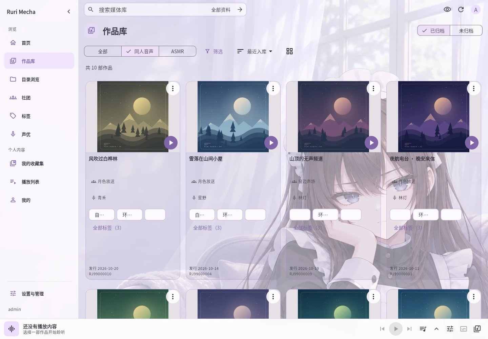
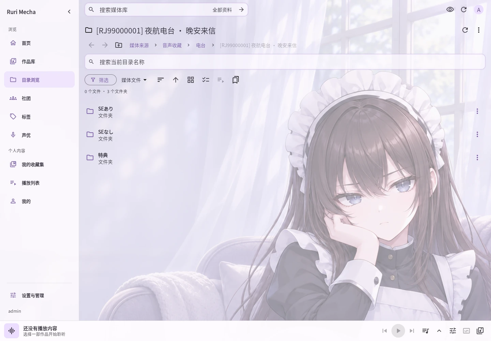
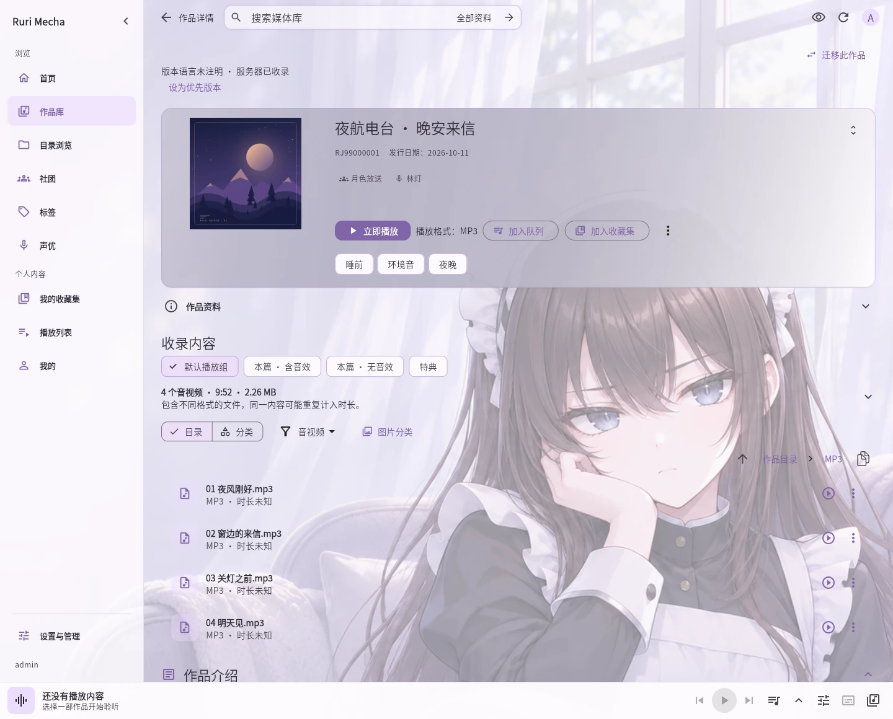
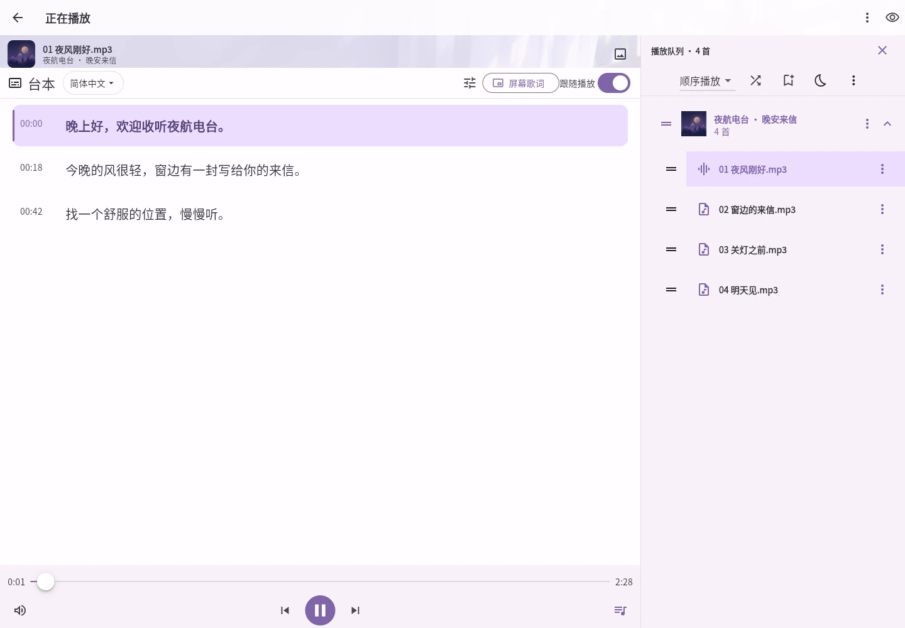
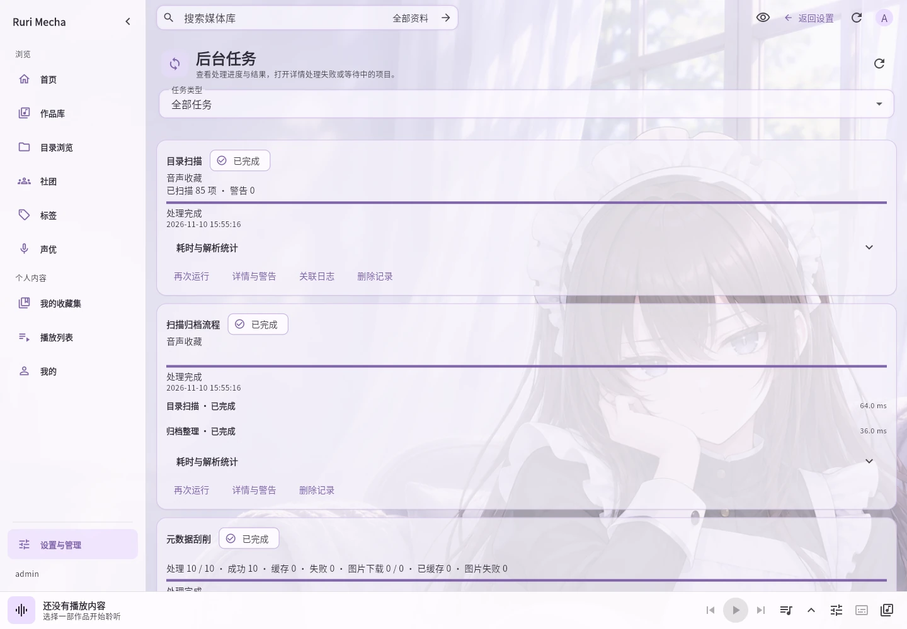

# 🤖 Rurimecha · 琉璃音声管家

> *「主人，音声库我已经整理好了。今晚想从哪一部接着听？」*

**Rurimecha（简称 Ruri）** 是装在自己电脑或服务器上的音声与 ASMR 媒体库。收藏可以散在几块硬盘上，按社团、年份或自己的习惯摆放。把目录交给 Ruri，就能在浏览器里找作品、选版本、接着听。

[下载 Ruri](https://github.com/rurimecha/rurimecha/releases) · [安装与使用](docs/USAGE.md) · [功能一览](docs/FEATURES.md)

## 👧 关于 Ruri

Ruri 是作品库里的机器人女仆。她在后台扫描文件、整理作品和补齐资料，把音效版、无音效版和特典分开放好。你手工改过的标题和标签可以保留，音视频原文件也留在你原先放置的位置。

## ✨ 核心特性

### 📁 保留原目录，按作品整理

- **目录怎么放，由你决定。** 可以分别添加按社团、年份或硬盘划分的目录，按原来的文件夹浏览，也可以让 Ruri 根据目录和作品编号归档。
- **一部作品可以有多种听法。** 音效版、无音效版、不同格式和特典可以分别浏览和播放。也可以手动指定作品目录、调整文件归属和播放顺序。
- **从文件夹里发现合集。** 整理媒体库时，Ruri 会识别「某社团合集」「某作者全集」这类目录。在「收藏集 → 智能发现」里，既能点开其中的每部作品，也能播放散放在目录里的音视频，还能一次把整份合集加入队列或播放列表。

### ⚡ 并行扫描与局部更新

多个媒体来源可以并行处理，扫描、归档、刮削和媒体信息提取可以分别开启。补了字幕或曲目后，可以只重扫发生变化的目录，在「后台任务」查看进度和结果。

在一次 Linux 本地模拟测试中，5 万个目录和空文件的扫描约用 **6 秒**，归档约用 **4 秒**。实际耗时取决于硬盘、挂载方式和目录内容。

### 🌐 DLsite 并发刮削与多语言资料

一次为多部带 RJ 编号的作品获取标题、声优、标签、封面和介绍。可以调整同时处理的作品数，保留手工修改，并单独重试失败项目。

简体中文、繁体中文、日文和英文资料可以分别获取、保存和更新。已关联的原作和其他语言版本可以一起浏览。可以听日文原版，同时看中文介绍。

### 🌟 让没有 RJ 编号的音声也有位置

独立社团作品、展会带回的音声，以及按自己习惯命名的 ASMR 文件夹，都可以加入作品库。可以手动指定作品目录，补上标题、简介和标签，从作品内挑一张图片当封面，再按自己的习惯整理播放版本。

### 🎧 找到作品，从上次的位置接着听

- 按标题、声优、社团、标签或编号搜索。输入 `RJ12` 这类编号开头即可查看候选。
- 播放时查看字幕和台本、设置睡眠定时。开启隐私模式后，可以遮住封面、标题和字幕。
- 可以用支持 WebDAV 的播放器只读浏览和播放原文件，也可以连接 Kikoeru 兼容音声库，把选中的作品加入自己的媒体库。

### 🎶 整部作品一起排，音频和视频接着播

- **拖动一次，整部作品一起移动。** 把一部作品、一个文件夹或一份合集加入队列或播放列表时，里面的音视频会作为一组。可以折叠后拖动整组，也可以展开调整组内顺序，或把某一项移出组合单独排。
- **音频和视频可以放在同一份队列或播放列表里。** 比如先听一部作品的正文，再看它的特典视频，最后接着听下一部。排好后点「保存为播放列表」，下次打开时，顺序和分组都还在。

### 🎬 从全屏看视频，到收起画面继续听

- 在「正在播放」里可以看视频、选字幕，也可以全屏观看。全屏时仍可换字幕，有章节的视频也可以直接跳转。进出全屏会接着当前进度，播到下一段视频时可以继续全屏，播到音频时会自动切回音频播放器。
- 在网页里返回媒体库时，画面收起，播放继续，仍可用底部播放器控制进度和队列。在 Android 上离开视频画面后，有音轨的视频可以继续听，无音轨的视频会暂停。

## 💎 服务器授权与功能

| 功能 | 未激活服务器授权 | 已激活服务器授权 |
| --- | --- | --- |
| 网页媒体库与 WebDAV | 内置管理员可用网页整理、搜索和播放，也可通过第三方 WebDAV 播放器浏览播放 | 可为其他用户创建账号，各账号分别保存收藏、偏好和进度 |
| 珍藏片段 | 可收藏整部作品或整首曲目 | 在播放器里选定一段音频或视频的起止时间，试听后保存。之后可以单独播放这段，也可以加入播放列表或收藏集 |
| Android 客户端 | 可搜索局域网服务器，已下载内容可在本机离线播放 | 连接服务器在线播放，或下载音视频原文件、作品资料、封面和可用字幕 |
| 备份与换机 | 内置管理员可导出和恢复系统数据、全部作品资料或单部作品资料 | 同样可由管理员操作 |

比如，把一首 20 分钟音声里最喜欢的 `02:15–02:45` 存成珍藏片段，下次点开就能直接听这 30 秒。Ruri 保存的是原文件的播放范围，重听时需要原文件可用。[珍藏片段使用方法](docs/USAGE.md#珍藏片段)

Linux、Windows 和 Docker 发行版自带 FFmpeg 和 FFprobe，启动即可使用兼容转码、音量标准化和内嵌字幕。[音视频工具](docs/USAGE.md#准备音视频工具) · [服务器授权与账号](docs/USAGE.md#服务器授权与账号)

## 🖼️ 界面预览

截图来自实际运行的 Ruri 网页，作品、封面、音频和台本均为演示资料。

### 目录浏览

### 作品详情

### 播放与台本

### 后台任务

## 🚀 快速部署

- **Linux（x86-64）**。解压发行包，运行 `sudo ./install.sh` 安装并启动服务，再用浏览器打开 `http://127.0.0.1:8080/`。
- **Docker（x86-64）**。按手册填写 Compose 配置，启动后打开 `http://127.0.0.1:8080/`。
- **Windows（x64）**。安装桌面客户端，再从开始菜单打开 Ruri。Android 客户端单独安装。

首次打开时按提示设置管理员密码，然后点首页的「添加媒体路径」，选中存放音声的文件夹。

[下载 Ruri](https://github.com/rurimecha/rurimecha/releases) · [启动与首次登录](docs/USAGE.md#安装与首次登录)

## 免责声明

Rurimecha 是用于整理和播放音声的自托管软件。Rurimecha 项目不提供、托管、销售或分发音声作品。媒体文件由用户自行添加，或来自用户自行配置的第三方来源。

免费功能和激活服务器授权后可用的功能均仅限个人非商业使用。不得使用 Rurimecha 向第三方提供商业服务，例如收费托管或出售媒体库访问权限。

以上使用限制仅适用于 Rurimecha 自有软件。随包的 FFmpeg 和 FFprobe 按 GPLv3 或更新版本提供。可按该许可使用、修改和再分发，并从同一发行页下载对应源码。其他第三方组件按各自的许可证使用。[发行下载](https://github.com/rurimecha/rurimecha/releases)

音声作品及其封面、台本等内容的著作权和相关权利归相应权利人所有。Rurimecha 的服务器授权仅用于启用软件功能。请在适用法律和作品授权允许的范围内使用内容，并遵守所连接的第三方服务条款。

用户对自行添加或下载的内容、所配置的第三方来源，以及通过自己的服务器分享内容的行为负责。向他人开放媒体库前，请确认你有权分享其中的作品。
