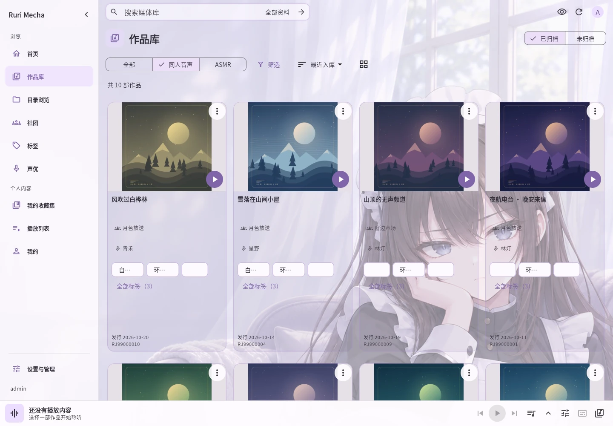
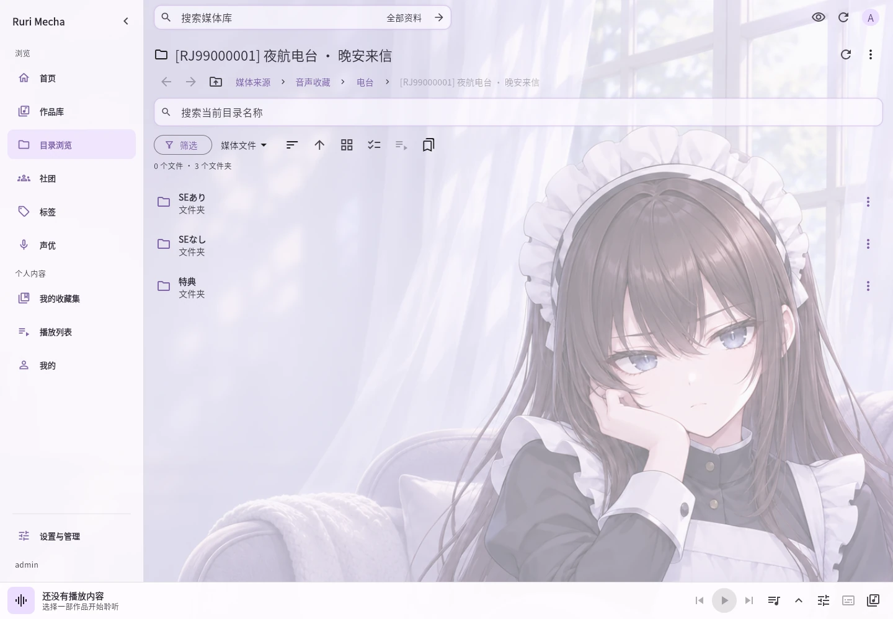
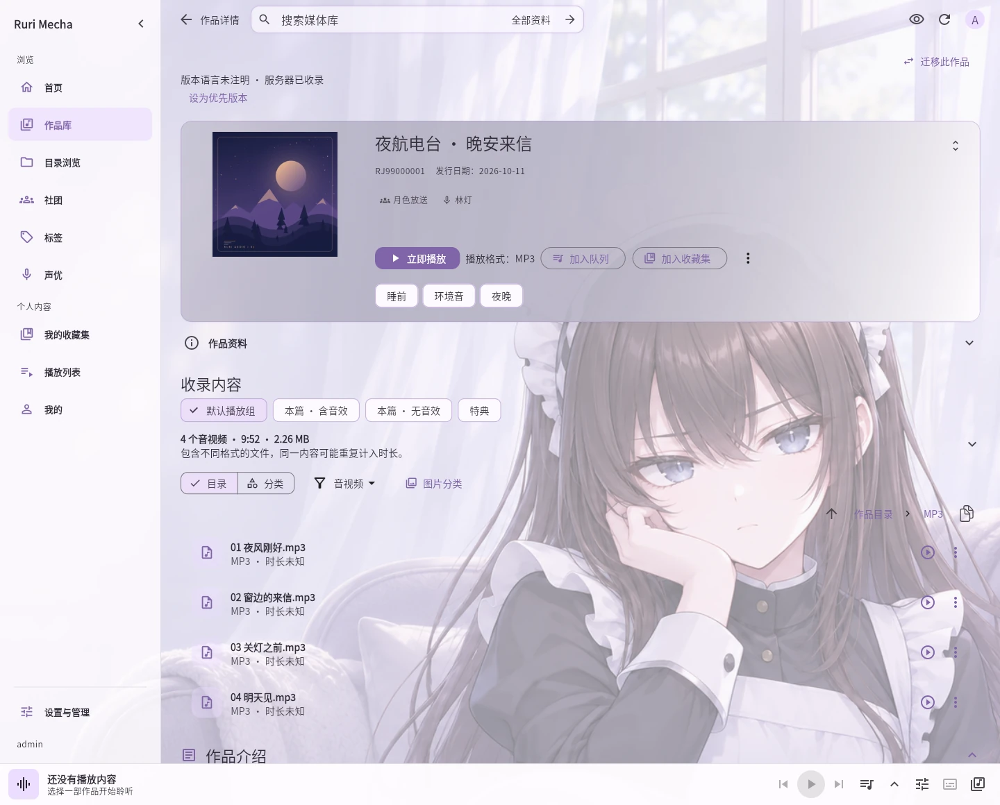
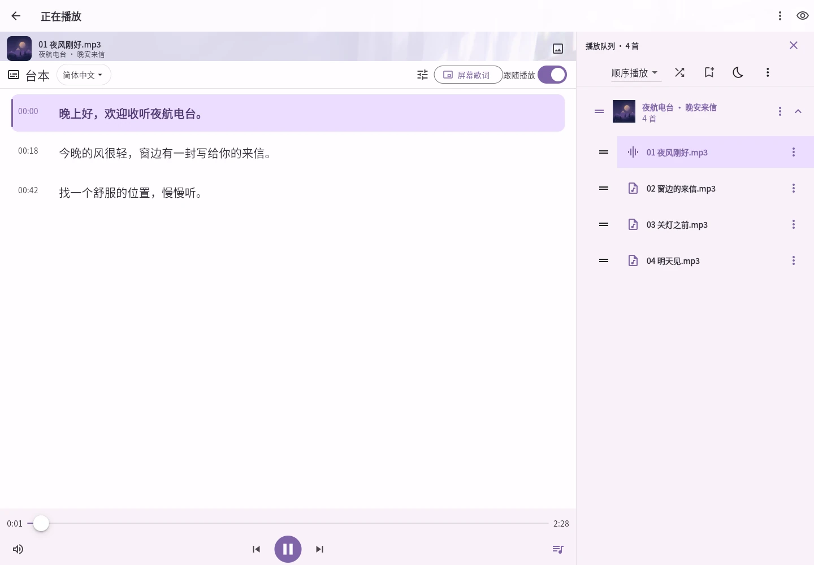
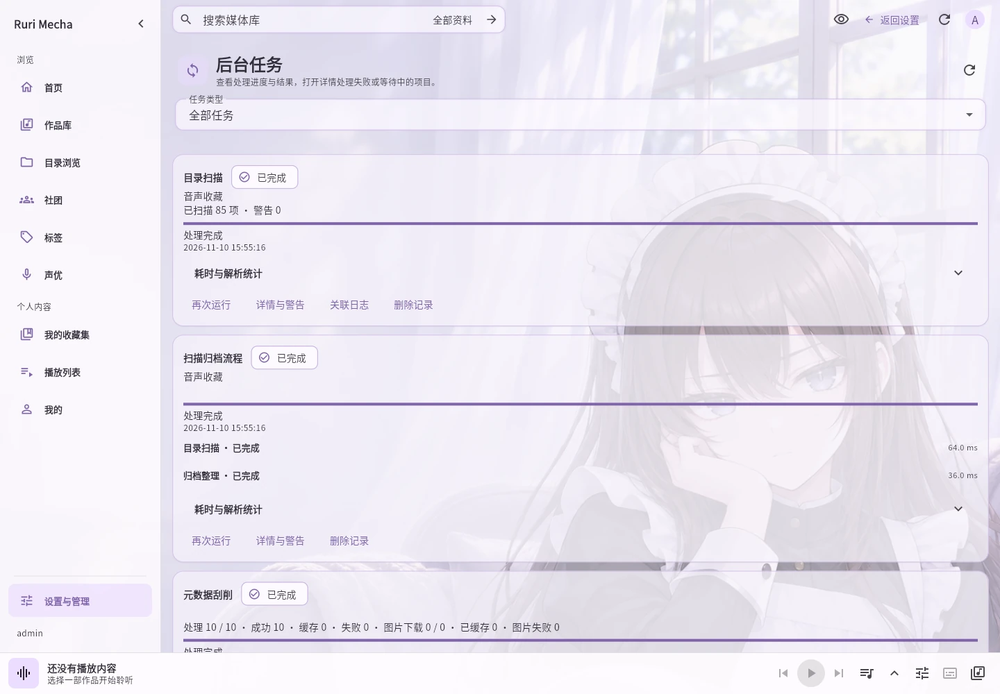

# 🤖 Rurimecha · 琉璃音声管家

> *「主人，音声库我已经整理好了。今晚想从哪一部接着听？」*

**Rurimecha（简称 Ruri）** 帮你整理和收听自己收藏的音声、ASMR 与视频。把存放媒体的文件夹添加进来，就能按封面找作品、选择音效版或不同格式、查看台本，并从上次的位置接着听。媒体原文件保留在原来的位置。

[在线演示](https://asmr.rurimecha.top/) · [下载 Ruri](https://github.com/rurimecha/rurimecha/releases/latest) · [安装与使用](docs/USAGE.md) · [功能一览](docs/FEATURES.md)

想先体验浏览和播放，可以打开[在线演示站](https://asmr.rurimecha.top/)，在登录页选择「游客体验」。游客不能修改作品，也不保存收藏和收听进度。

## 从这里开始

1. **选择安装方式。** 在 Windows 电脑上使用，下载 `.msi` 安装包；在 Linux 电脑或 NAS 上使用，可选择 Linux 服务器包或 Docker。手机另外安装 Android `.apk`，再连接已运行的 Ruri。
2. **设置管理员密码。** 按[首次登录说明](docs/USAGE.md#首次设置管理员密码)找到设置码，输入两遍新密码，之后用 `admin` 登录。
3. **添加媒体。** 在首页点「添加媒体路径」，选择运行 Ruri 的电脑上的文件夹。等待「后台任务」完成后，打开作品库即可播放。Docker 用户选择映射后的 `/media/library`。

| 你要在哪里运行 | 安装方式 | 接着做什么 |
| --- | --- | --- |
| Windows 64 位电脑 | 下载 MSI，安装后从开始菜单打开 Rurimecha | [Windows 安装](docs/USAGE.md#windows-安装) |
| Linux x86-64 电脑或 NAS | 解压服务器包，运行 `sudo ./install.sh` | [Linux 安装](docs/USAGE.md#linux-安装) |
| 已安装 Docker 的 x86-64 设备 | 下载 Compose 包，填写媒体路径，运行 `docker compose up -d` | [Docker 安装与端口设置](docs/USAGE.md#docker-安装) |
| Android 手机 | 安装 APK，填写服务器地址并登录 | [在 Android 上收听](docs/USAGE.md#在-android-上收听) |

Docker 示例初始只允许安装它的电脑访问。要让手机、平板或其他电脑连接，需要同时设置端口映射和 Ruri 的局域网范围，具体步骤见上表。手机里的 `127.0.0.1` 指手机自己，不能用来连接 NAS 或电脑。

## 可以用它做什么

### 整理作品，保留原来的文件夹

- 按原目录浏览，也可以自动把文件整理成作品，按作品提供的音效版、无音效版、格式和特典分别展示。
- 没有 RJ 编号的音声也能收录。你可以指定作品目录，填写标题、简介和标签，并选择封面。
- 添加目录后可自动查找变化，也能手动刷新，在「后台任务」查看结果。
- 「收藏集 → 智能发现」可浏览识别出的合集；自己常听的内容可以另存为自定义收藏集或播放列表。

### 找资料，也找下一部想听的作品

- 按标题、声优、社团、标签或作品编号搜索；只记得标题时可以选择「仅标题」。
- 为带 RJ 编号的作品从 DLsite 获取标题、介绍、封面等资料。来源缺少的内容可以手工补充。
- 简体中文、繁体中文、日文和英文资料可分别保存。有关联的原作与语言版本时，可以选择播放哪份文件，同时阅读另一种语言的介绍。
- 可以连接支持的 kikoeru 兼容音声库，选择作品加入自己的媒体库。兼容性和能否播放取决于来源实际提供的文件。

### 播放、续听和收藏

- 音频和视频可加入同一份队列或播放列表。整部作品可以作为一组移动，也能展开调整曲目顺序。
- 播放时查看字幕或台本、使用睡眠定时、从收听记录继续播放；管理员可新建、编辑和转换台本。
- Android 支持后台播放、通知控制和悬浮字幕。连接已授权服务器后，可下载原文件到手机，完成后在「本机媒体库」离线收听。
- 隐私模式可以遮住封面、视频和作品文字；Android 可在外放前询问，耳机断开时暂停。
- 支持 WebDAV 的播放器可使用 Ruri 账号浏览和播放原文件。Windows 文件资源管理器使用 HTTP 连接时可能需要调整系统设置，见 [WebDAV 连接与排错](docs/USAGE.md#用其他播放器或文件管理器连接)。

Linux、Windows 和 Docker 发行版已附带音视频工具。支持的本地文件可以进行兼容转码、音量标准化和读取内嵌字幕；实际能否处理取决于文件格式。kikoeru 兼容来源直接播放其提供的原文件。[播放说明](docs/USAGE.md#播放与续听)

## 服务器授权与账号

| 使用方式 | 可以做什么 |
| --- | --- |
| 未激活服务器授权 | 内置管理员可以使用网页和 WebDAV 整理、搜索、播放，以及导出和恢复资料 |
| 服务器授权有效 | 还可创建其他账号、使用官方 Android 客户端在线播放和下载、保存珍藏片段 |
| 已下载到手机 | 下载完成的内容可离线收听，不要求服务器保持在线 |

多个账号共享作品库，各自保存收藏、播放列表、偏好和收听进度。珍藏片段保存原文件中的一段播放范围，收听时仍需要原文件可用。你可以把一首音声中的 `02:15–02:45` 单独保存，下次直接听这 30 秒。

[授权与账号](docs/USAGE.md#服务器授权与账号) · [珍藏片段](docs/USAGE.md#珍藏片段) · [升级](docs/USAGE.md#升级现有安装) · [换机与恢复](docs/USAGE.md#换机与恢复)

## 界面预览

截图来自实际运行的 Ruri 网页，作品、封面、音频和台本均为演示资料。

### 目录浏览

### 作品详情

### 播放与台本

### 后台任务

需要连接其他客户端或开发自己的工具，请查看 [公开 API 文档](docs/api/README.md)。日常安装和使用不需要阅读接口文档。

## 免责声明

Rurimecha 是用于整理和播放音声的自托管软件。Rurimecha 项目不提供、托管、销售或分发音声作品。媒体文件由用户自行添加，或来自用户自行配置的第三方来源。

免费功能和激活服务器授权后可用的功能均仅限个人非商业使用。不得使用 Rurimecha 向第三方提供商业服务，例如收费托管或出售媒体库访问权限。

以上使用限制仅适用于 Rurimecha 自有软件。随包的 FFmpeg 和 FFprobe 按 GPLv3 或更新版本提供。可按该许可使用、修改和再分发，并从同一发行页下载对应源码。其他第三方组件按各自的许可证使用。[发行下载](https://github.com/rurimecha/rurimecha/releases)

音声作品及其封面、台本等内容的著作权和相关权利归相应权利人所有。Rurimecha 的服务器授权仅用于启用软件功能。请在适用法律和作品授权允许的范围内使用内容，并遵守所连接的第三方服务条款。

用户对自行添加或下载的内容、所配置的第三方来源，以及通过自己的服务器分享内容的行为负责。向他人开放媒体库前，请确认你有权分享其中的作品。
