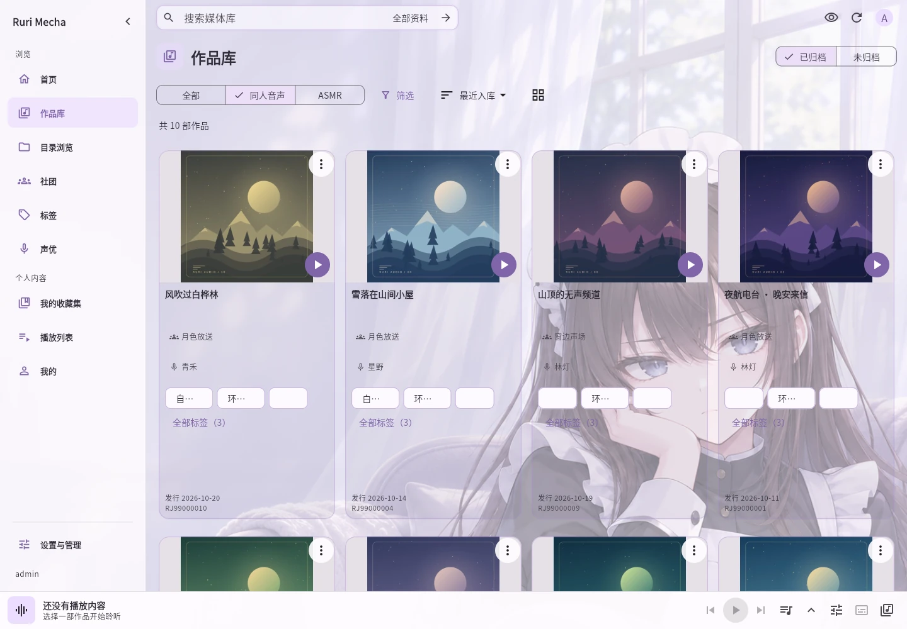

# Rurimecha · 你的私人 ASMR 與同人音聲作品庫

[简体中文](README.md) · [繁體中文](README.zh-Hant.md) · [日本語](README.ja.md) · [English](README.en.md)

依聲優、社團、標題或 RJ 編號尋找作品，選擇音效版或無音效版，邊看台本邊聽，並從上次的位置繼續。加入自己提供的媒體資料夾；Ruri 不提供音聲作品。

[體驗示範站](https://asmr.rurimecha.top/) · [下載](https://github.com/rurimecha/rurimecha/releases/latest) · [使用指南](docs/i18n/zh-Hant/USAGE.md)

示範站可選擇訪客體驗；訪客的收藏和收聽進度不會儲存。

- 依封面、聲優、社團、標籤或 RJ 編號尋找作品，取得支援的資料或自行編輯。
- 按作品整理收藏集、在播放清單保存順序，也可瀏覽智能發現。
- 查看帶時間的台本、設定睡眠定時、前後跳轉 10 秒並從上次位置繼續。
- 以隱私模式遮住封面和文字；Android 支援背景播放和懸浮字幕。

Windows 可使用 MSI 安裝程式，無需命令列。Linux 和 Docker 用於執行 Ruri 伺服器；Android 連接已執行的伺服器。內建管理員無需授權即可使用網頁和 WebDAV；Android 線上播放、下載與珍藏片段需要有效伺服器授權。下載完成後可離線收聽。

測試期間免費。未來收費暫定人民幣 10 元／月、60 元／年或 90 元永久授權，可綁定 3 台伺服器，Android 等客戶端不單獨佔用綁定名額；最終方案以正式公布為準。現有免費功能不會改為付費。目前免費測試授權需申請審核，發放後須在 7 天內首次啟用，首次啟用後可使用 31 天。

[Features](docs/i18n/zh-Hant/FEATURES.md) · [使用指南](docs/i18n/zh-Hant/USAGE.md)

Ruri 僅供個人非商業使用，不提供或分發音聲作品。請遵守內容授權、來源服務條款及適用法律。同捆的 FFmpeg 與 FFprobe 依 GPLv3 或更新版本提供，對應原始碼可從發行頁下載。[使用限制](README.md#免责声明)
