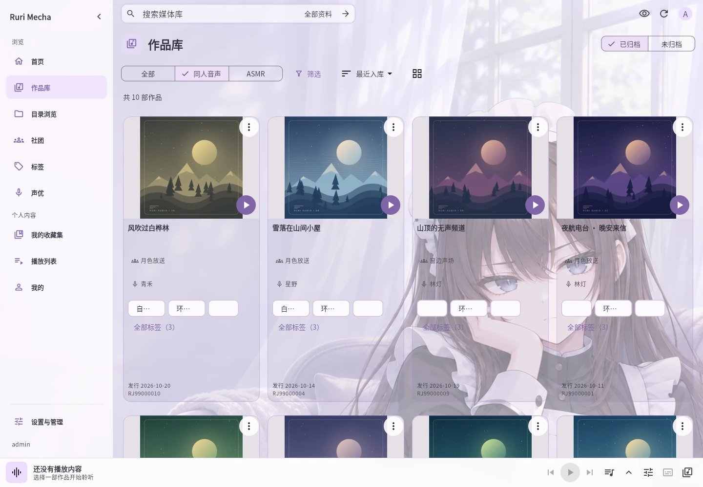

# Rurimecha · 你的私人 ASMR 與同人音聲作品庫

[简体中文](README.md) · [繁體中文](README.zh-Hant.md) · [日本語](README.ja.md) · [English](README.en.md)

依聲優、社團、標題或 RJ 編號尋找作品，選擇音效版或無音效版，邊看台本邊聽，並從上次的位置繼續。加入自己提供的媒體資料夾；Ruri 不提供音聲作品。

[體驗示範站](https://asmr.rurimecha.top/) · [下載](https://github.com/rurimecha/rurimecha/releases/latest) · [使用指南](docs/i18n/zh-Hant/USAGE.md)

> **從 0.3.0 以前的版本升級時，請一併更新伺服器和 Android 用戶端。**

示範站可選擇訪客體驗；訪客的收藏和收聽進度不會儲存。

- 依封面、聲優、社團、標籤或 RJ 編號尋找作品，取得支援的資料或自行編輯。選擇「更多聲優」可瀏覽媒體庫以外的聲優。
- 在「目錄」開啟內建 ASMR.one，無需輸入網址即可瀏覽並加入作品。也可連線至 Kikoeru 相容音聲庫。
- 按作品整理收藏集、在播放清單保存順序，也可瀏覽智能發現。
- 查看帶時間的台本、設定睡眠定時、前後跳轉 10 秒並從上次位置繼續。
- 以隱私模式遮住封面和文字；Android 支援背景播放和懸浮字幕。

Windows x64 使用 MSI 安裝，完成後從開始功能表開啟 Rurimecha。Linux 的 x86-64 裝置請選 `amd64` 完整套件，ARM64 裝置請選 `arm64`。Docker 在兩種架構上使用同一個映像標籤。Android 安裝 APK 後可播放手機裡的檔案或連線至伺服器。內建管理員無需伺服器授權即可播放與下載一般曲目，下載完成後可離線收聽。

珍藏片段、AI，以及伺服器上的多使用者帳號和智慧選路需要授權。伺服器授權有效時，管理員可為其他人建立個人帳號。伺服器與 Android 手機可用同一組金鑰分別啟用，每台各占一個名額。連線至伺服器媒體庫時使用該伺服器的授權。在 Android 本機媒體庫的「AI 設定」中選好模型後，可翻譯作品資料。使用雲端模型時需要連線。

可在「設定 → 版本與更新」或 Android 連線頁面檢查更新。Windows 開啟新版 MSI，Android 依系統提示安裝。Linux 管理員在主機上執行新版安裝程式，Docker 使用者依指南替換映像。

可在 Ruri 官網填寫電子郵件領取有 2 個裝置名額的免費測試授權。伺服器和 Android 本機媒體庫可用同一組金鑰分別啟用，各占 1 個名額。發放後須在 7 天內首次啟用，自首次啟用起可使用 31 天。預計每台裝置的授權為人民幣 5 元／月，或 30 元永久授權。最終方案以正式公布為準。 [Ruri 官網](https://rurimecha.top/)

[功能一覽](docs/i18n/zh-Hant/FEATURES.md) · [使用指南](docs/i18n/zh-Hant/USAGE.md)

Ruri 僅供個人非商業使用，不提供或分發音聲作品。請遵守內容授權、來源服務條款及適用法律。同捆的 FFmpeg 與 FFprobe 依 GPLv3 或更新版本提供，對應原始碼可從發行頁下載。[使用限制](README.md#免责声明)
